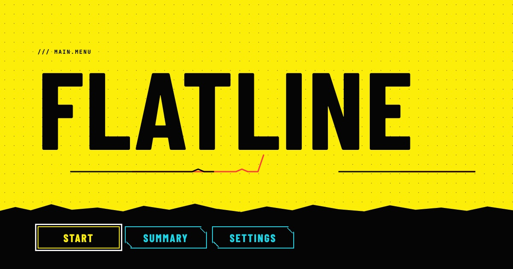

# Flatline

A cyberpunk survival story that runs in your browser. You play Kade, a courier with a stolen prototype chip in their spine and six hours to live. Every death teaches the game something, and **the game remembers**: locked choices open, characters react, and the voice in your head gets clearer.



**Play it:** _add your Netlify link here_

- 3 acts, 23 scenes, 10 endings (5 deaths, 4 survivals, 1 secret)
- Make a choice, pay its cost in time, health or heat, die or survive, wake up again knowing more
- The interface decays as you die: colours drain and the text gets a red and cyan ghost when time or health runs out
- No backend, no accounts, no tracking. Progress lives in your browser

> **Built with Claude Code.** I wrote the story and the design brief; the code was built with Anthropic's Claude Code, working step by step from the written plan in [`blueprint/`](blueprint/) and the rules in [`CLAUDE.md`](CLAUDE.md). The commit history shows the steps.

## Contents

[How to play](#how-to-play) · [Run it locally](#run-it-locally) · [Stack](#stack) · [How it works](#how-it-works) · [Run memory](#run-memory) · [Writing the story as data](#writing-the-story-as-data) · [Accessibility](#accessibility) · [Testing](#testing) · [Privacy and security](#privacy-and-security) · [Interesting technical decisions](#interesting-technical-decisions) · [Known limits](#known-limits)

## How to play

| | |
| --- | --- |
| **Layout** | The story is on the left in a panel of fixed height that scrolls on its own (it follows the text as it types, and a visible scrollbar and a quiet fade at the bottom show when there is more to read, and the arrow keys scroll it when it has focus). Your choices are on the right and the endings you have found sit underneath, so the whole game fits one screen. On a phone, or when the eye payment leaves less room, it stacks into one column and the page scrolls as normal |
| **Choose** | Click a choice, or press **1 to 4** |
| **Skip the typing** | Click the story, or press **Escape**, **Enter** or **Space** (a "Show all text" button is there too) |
| **Continue** | **Enter** presses a lone "Continue", and wakes you up again after an ending |
| **Locked choices** | Shown greyed out with a dashed border and no hint. They open because of what happened in earlier runs |
| **Stuck, or hunting every ending?** | **Summary** (title screen or game header) is a recap of the story and a guide to all ten endings, behind a spoiler warning. It marks the endings you have found |
| **Calm mode, sound, text speed** | Settings (there is also a quick Sound button in the game header). Calm mode removes glitching and flicker |

Time only moves when you choose. The chip also takes 1 health for every hour of story time that passes.

## Run it locally

You need Node 22 and npm.

```bash
npm install
npm run dev        # local dev server
npm run build      # production build into dist/
npm run preview    # serve the production build
npm run test       # Vitest, 350 tests in 27 files
npm run lint       # ESLint
npm run typecheck  # tsc, strict mode
```

Add `?debug` to the address (or use `npm run dev`) for the **debug panel**: jump to any scene, set time, health and heat, toggle any flag, set deaths, and one-click presets such as "Last choice, Merged unlocked". It is loaded as a separate chunk, so ordinary players never download it.

## Stack

| | Why |
| --- | --- |
| **Vite + React 19 + TypeScript (strict)** | Fast to work in, and strict types keep the story data honest |
| **Plain CSS with custom properties** | One token file for colours, type and spacing. No Tailwind, no CSS-in-JS, no UI library |
| **Vitest** | Tests the engine as plain functions, no browser needed |
| **Web Audio API** | All sound is generated, so there are no audio files and nothing to license |
| **Netlify** | Static hosting, with security headers set in [`netlify.toml`](netlify.toml) |

Only two runtime dependencies: `react` and `react-dom`. Fonts (Barlow Condensed, IBM Plex Sans, JetBrains Mono) come from Google Fonts.

## How it works

The rule that shapes everything: **the engine is pure TypeScript with no React and no DOM.** Components only draw state and call `choose()`. Story logic never lives in a component.

```
src/
  engine/       Pure game logic and its tests
  story/        The three acts as JSON, plus the story checker
  components/   React UI: HUD, scene, choices, endings, screens
  hooks/        Wires the engine to React (useGame, useReveal, useSound, ...)
  audio/        The Web Audio sound engine
  styles/       tokens.css, base.css, decay.css
blueprint/      The plan, the script and the progress log
```

```
click or key  →  useGame  →  choose(story, state, choiceId)  →  new GameState  →  React draws it
                                   │
                                   └─ checks the lock · pays the cost · follows the branch ·
                                      applies the next scene's effects · records an ending
```

### Game state

A `GameState` holds two things:

- **Run state**, which resets every run: `time` (seconds left, starting at 21600), `health` (0 to 5), `heat` (0 to 5), the current scene, this run's flags, inventory, and whether painkillers are blurring your text.
- **Memory**, which persists across runs (see below).

### The pure functions

| Function | What it does |
| --- | --- |
| `isConditionMet(condition, state)` | Answers "does this apply right now?" for flags, items, stats and `not` / `all` / `any`. A locked choice is just a `requires` that returned false |
| `applyEffect(state, effect)` | Applies a cost or reward: clamps health and heat to 0 to 5, sets flags, adds or uses items, and takes the chip's hourly health drain. Returns a new state and never changes the old one |
| `choose(story, state, choiceId)` | The run loop. Returns `{ ok: true, state }` or `{ ok: false, reason }`. Never throws for player input |
| `endRun(state, scene)` | Records an ending once, adds a death, and counts a flatline |

### Automatic rules

- If time or health hits zero in any scene, the player lands on the **Flatline** ending, unless the choice was already heading for a death.
- Every death adds 1 to `deaths`. Starting a run never changes memory.
- A choice's own cost is paid first, then the chip's drain: `health lost = full hours elapsed after the choice − full hours elapsed before it`. It is worked out from the clock, so there is no counter to get out of step and no hour can be charged twice.

## Run memory

What the game remembers is a small versioned object saved in `localStorage` under `flatline:v1`:

```ts
type Memory = {
  version: 1
  deaths: number
  flatlines: number
  runs: number
  endingsSeen: string[]
  memoryFlags: string[]   // what past runs taught the game
}
```

Memory is what makes a replay feel different:

- **Locked choices open.** A choice with `requires: { stat: 'deaths', gte: 2 }` is greyed out on run one and available on run three.
- **Scenes change.** Any line can carry a `when` condition, so a scene reads differently if you died a particular way before.
- **The chip's voice changes.** How hard its text glitches depends on how many times you have died (`chipVoice(deaths)`).
- **The interface remembers too.** Found endings are tracked as "ENDINGS 3/10", with unfound ones kept as anonymous silhouettes so nothing is spoiled.

### Keeping the save safe

Everything read from storage or from a pasted save code goes through **one validator** (`parseMemory`), which rebuilds the object field by field, drops unknown fields, removes duplicates and rejects wrong types, negative counts and unknown versions. Storage is passed in rather than reached for, and every read and write is wrapped in `try/catch`, so the game still starts, and says why, if storage is blocked, full or holds a corrupted save. Settings live under their own key so they can never change the save format.

Settings → **Export** gives a base64 save code you can copy; **Import** takes one back. Importing and resetting both ask first, in an in-game dialog.

## Writing the story as data

Scenes are plain JSON, one file per act. This is a real choice from the first scene:

```json
{
  "id": "listen-to-the-chip",
  "label": "LISTEN TO THE CHIP",
  "requires": { "stat": "deaths", "gte": 2 },
  "effect": { "time": -600 },
  "goto": "scene-12"
}
```

A scene has text blocks (`text`, `chip` for the chip's lines, `system` for interface notes), choices, optional `onEnter` effects (for example, what an ending teaches the next run), and an optional `ending`. Variants are just blocks with a `when` condition. A choice can also branch with `gotoIf`.

### The story is checked by a test

`validateStory` reads every act and reports, in plain sentences: gotos that point nowhere, scenes with no way out, scenes nobody can reach, flags and items that are used but never set, duplicate ids, malformed conditions and effects, and script formatting that leaked into the text. It is tested against deliberately broken stories as well as the real one, so a green result means something. The "all ten endings can be reached" tests then play the real story through the engine.

## Accessibility

Accessibility was part of "done" for every step, not a final pass. A full audit is in [`blueprint/progress.md`](blueprint/progress.md).

- **Keyboard only, start to finish.** Every control is reachable and shows a visible focus ring. Number keys 1 to 4 choose. A choice that removes its own button moves focus to the next one, the game and settings screens move focus to their heading, and the title starts on its Start button.
- **Screen readers.** A live region announces what each choice cost ("Time minus 20 minutes. Heat up 1."), what was used, and when the interface resets. While text is typing, a hidden copy gives the whole paragraph at once and the animated copy is hidden from assistive technology, so nobody hears it letter by letter. Locked choices stay focusable (`aria-disabled`, not `disabled`) and say "locked", with no hint how to open them.
- **Motion.** `prefers-reduced-motion` and the Calm mode switch both turn off glitching, flicker, rain and typing. Colour drain stays, because it is a static change, not motion. Calm mode defaults to the system setting on a first visit.
- **Contrast.** Every text colour meets WCAG AA on both backgrounds, including at full colour drain (computed, and the red heat number is large text so it still passes). The eye payment's black left third moves the story aside instead of covering it, so no word sits under the dark.
- **Touch targets** are at least 44 px, and the layout works at 320 px and with text at 200%.
- **Structure.** One `h1` per screen, headings in order, labelled regions, native `<dialog>` for confirmations, and decorative art hidden from assistive technology.

## Testing

**350 tests in 27 files**, run with `npm run test`:

- **Engine:** conditions, effects, the hourly drain, the run loop, memory and save codes, settings upgrades, decay, sound rules, and the debug tools.
- **The story itself:** the validator, and scripted runs that reach each of the 10 endings, including the fastest path to the secret one (three runs, two deaths). The ending guide is checked against the script's own table word for word, and against the endings in the game.
- **UI:** components are rendered to a string and checked, with no browser or testing library.
- **Sound:** the audio engine is tested against a fake audio context, including "nothing is created until sound is turned on".
- **Shipping:** the page head, the security headers and the privacy rule (below).

Beyond unit tests, the game was played in headless Chrome over the DevTools protocol: real key presses, reloads, throttled loading, and Chrome's built-in contrast and accessibility checks. I also broke things on purpose (a renamed flag, a planted tracker address) to confirm the tests go red.

## Privacy and security

No analytics, no cookies, no tracking, and no requests to anyone but Google Fonts. This is enforced, not just promised:

- `netlify.toml` sets a **Content-Security-Policy** with no inline scripts and no `eval`, and only Google Fonts allowed from outside. It also sets `nosniff`, a referrer policy and a permissions policy, blocks framing, and caches the hashed files for a year.
- A test fails if the policy loosens, or if any other web address appears in the page or the code.

## Interesting technical decisions

Each of these is something I can explain, with the trade-off.

1. **A pure engine and a typed result.** `choose` returns `{ ok, state }` or `{ ok: false, reason }` instead of throwing, and never mutates. The UI cannot crash the engine, a locked choice cannot be forced through, and the whole game is testable as plain functions. The trade-off is a little more plumbing in `useGame`.
2. **The hourly drain comes from the clock, not a counter.** Ten 10-minute choices and one 100-minute choice drain the same, and an hour can never be charged twice (the classic "health drains twice when a choice crosses an hour" bug). A heal is capped before the drain, so healing at full health cannot absorb it.
3. **One gate for untrusted data.** Storage and pasted save codes pass through `parseMemory`. There is one place to harden, test and later migrate, and it is also where the version check lives.
4. **Story as data, checked by a test.** Adding an act means adding a JSON file; the checker finds broken links before a player does. It also caught a real trap: Vitest cached a build-time file glob and silently skipped a new act file, so the test now reads the folder at run time.
5. **Decay is one CSS variable.** `--decay` (0 to 1, from time and health) is written on the root by one hook, and `decay.css` reads it. Components never set inline styles, which is also what lets the Content-Security-Policy ban inline styles.
6. **Motion has three independent switches that stack.** The system's reduced-motion setting, the Calm mode switch, and the always-on static colour drain. In CSS, every animation sits behind `@media (prefers-reduced-motion: no-preference)` and `:root:not([data-calm])`.
7. **Accessible text reveal.** The typewriter effect gives screen readers the full paragraph in a hidden copy and hides the animated copy from them. The unrevealed text keeps its space (`visibility: hidden`) so nothing jumps.
8. **Sound that is provably off until asked for.** `SoundEngine` takes a factory for the browser's audio context and creates nothing until `start()`. The hook only calls it when sound is on and the player has interacted. The test with a fake context proves it, and so did a recording wrapper in a real browser.
9. **Contrast is measured, including decayed states.** Computing contrast at full colour drain found that the red heat number dropped below 4.5:1, so it became large text (where 3:1 is enough). The eye-payment veil moves the story rather than darkening it for the same reason.
10. **Tests that can fail.** After adding a guard, I broke the thing it guards (a renamed flag, a planted web address) and watched it go red.

## Known limits

- **Runs are not saved midway.** Closing the tab mid-run starts the next run fresh, with everything you have learned so far. That fits the game, but it is a choice.
- **Not yet tried with a real screen reader**, only through the browser's accessibility tree. Forced-colours mode is untested.
- **The sound has only been checked by what the game asks the browser to play**, not by ear.
- Some script details are recorded as open questions in [`blueprint/progress.md`](blueprint/progress.md) (text that can't be shown as written, and a route whose balance I flagged).

## Credits

Story, design and direction: Emma. Code built with Claude Code. Fonts: Barlow Condensed, IBM Plex Sans and JetBrains Mono, via Google Fonts (SIL Open Font License).
